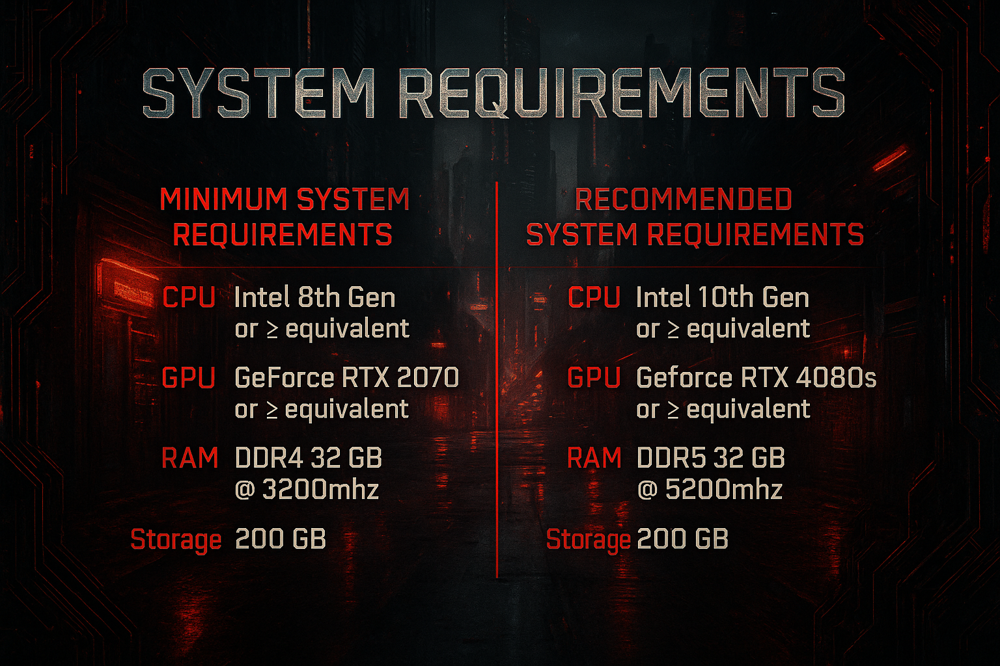

> [!IMPORTANT]
> Chrome & Blood 5.0 requires Cyberpunk 2077 2.5 for PC, Phantom Liberty, and REDmod. Start with the [installation guide](https://qcargile.github.io/Chrome-Blood/install.html).

## Table of Contents

- [Introduction](#introduction)
- [System Requirements](#system-requirements)
- [Preinstallation](#preinstallation)
- [Installation](#installation)
- [Post-Installation](#post-installation)
- [Updating the Modlist](#updating-the-modlist)
- [In-Game Guide & Settings](#in-game-guide--settings)
- [Known Issues](#known-issues)

## Introduction

**Chrome & Blood** reworks combat, AI, hacking, cyberware, and the economy for a harder playthrough of Cyberpunk 2077.

### Standard Profile

Chrome & Blood 5.0 has one player profile: **Chrome & Blood - Standard Profile**. The Immersive profile has been retired.

- Limited HUD is enabled by default; the HUD needs no special implant.
- Reload manually. Reloading early usually discards the ammunition left in the magazine.
- Fast travel charges a fare and advances the clock; dialogue checks are hidden.
- Dark Future Core is included as an optional module and disabled by default. Ultra+, World Builder, General Shadows Fixes, Draw Distance ReImagined, and ReImagined are also included but disabled. The graphical mods are temporarily off while we wait for their Cyberpunk 2.5 updates.
- Chrome Ballistics weapons, attachments, and schematics are sold by physical gunsmiths and melee vendors.

Existing saves are supported; a new game is recommended for 5.0. Back up saves and personal settings before updating.

Read [Rule 11](https://qcargile.github.io/Chrome-Blood/mods.html#rule11) before adding your own mods, and use the `[NoDelete]` tag to preserve additions across updates.

---

### What the List Includes

- **Frameworks:** CET, redscript, RED4ext, ArchiveXL, TweakXL, Codeware, and Unified Mod Settings are included.
- **Visuals:** [Nova City 2](https://www.nexusmods.com/cyberpunk2077/mods/12490), [Nova Optics](https://www.nexusmods.com/cyberpunk2077/mods/29190), HDR LUTs, upgraded civilians, and tuned weather/LOD/fog.
- **Combat:** Enemy Health is reduced, with separate tuning for ordinary enemies, elites, bosses, MaxTac, and machines. [ME Armor](https://www.nexusmods.com/cyberpunk2077/mods/30548), [Much Better AI](https://www.nexusmods.com/cyberpunk2077/mods/31402), [Cyber Enemies](https://www.nexusmods.com/cyberpunk2077/mods/30585), and faction traits create the difference between ordinary enemies and serious threats.
- **Weapons:** [Chrome Ballistics](https://www.nexusmods.com/cyberpunk2077/mods/22819) and [Damage Scaling and Balance - Extended](https://www.nexusmods.com/cyberpunk2077/mods/21865) rebalance weapon damage and progression.
- **Cyberware:** Realistic slot limits and expanded build options through [Neuralware - Chipware Expansion](https://www.nexusmods.com/cyberpunk2077/mods/19798) and the [Cyberware Improved](https://www.nexusmods.com/cyberpunk2077/mods/23554) series.
- **Perks:** [Merc Protocol – Perk Gameplay Expansion](https://www.nexusmods.com/cyberpunk2077/mods/26751) adds 18 new perks with unique mechanics built for this list.
- **Vehicles:** Reworked handling and a full garage of added cars and bikes through [Virtual Car Dealer](https://www.nexusmods.com/cyberpunk2077/mods/4454).
- **Stealth & Hacking:** [Much Better AI](https://www.nexusmods.com/cyberpunk2077/mods/31402) makes enemies investigate noise, react to bodies and takedowns, search your last known position, and coordinate after spotting you. Enemy netrunners reposition and support their squad, while [Much Better Netrunning](https://www.nexusmods.com/cyberpunk2077/mods/27237) overhauls hacking from the ground up.
- **Immersion:** [Immersive Fixers](https://www.nexusmods.com/cyberpunk2077/mods/15460), new street encounters, longer day/night cycles, and better ripperdocs change the world between story missions.
- **Economy:** [Gigs, loot, and rewards](https://www.nexusmods.com/cyberpunk2077/mods/30532) have been rebalanced through Much Better Eddies — steeper scaling, bigger payouts, and phone-ordered services.
- **Builds:** Added weapons, perks, and cyberware give you more build options.

### Repeatable Fixer Work

Visit **The Wire** through a computer's Net browser for Much Better Contracts. It sends you back to cleared gig and organized-crime locations for new assignments, with linked Operations across multiple sites. Successful work earns money and crafting specs, raises faction difficulty, and opens targeted sourcing. The Database guide explains acceptance, objectives, withdrawal, and rewards.

### The Point

This list isn't meant to be easy. With all of the above tuned for **very hard**, in Chrome & Blood's Night City, **survival isn't a right — it's earned.**

*Live Hard. Die Chrome.*

---

### Links

- **Website**: [qcargile.github.io/Chrome-Blood](https://qcargile.github.io/Chrome-Blood/)
- **Full Load Order**: [all mods](https://qcargile.github.io/Chrome-Blood/loadorder.html)
- **Player Guide**: [Find the in-game Database guide](https://qcargile.github.io/Chrome-Blood/guide.html)
- **Changelog**: [All Releases](https://qcargile.github.io/Chrome-Blood/changelog.html)
- **FAQ**: [Frequently Asked Questions](https://qcargile.github.io/Chrome-Blood/faq.html)
- **Discord**: [Chrome & Blood Community](https://discord.gg/U65Nhdcns8)
- **Nexus Collection**: [Add to Wabbajack](https://www.nexusmods.com/games/cyberpunk2077/collections/lrcdrr)

## System Requirements

Based on testing and community feedback. Performance varies with your graphics settings.

Requires an official PC copy of **Cyberpunk 2077 2.5**, **Phantom Liberty**, **REDmod**, Windows 10/11, and an SSD. Check Wabbajack's space requirements before installing and leave room for extraction and backups.

## Preinstallation

Update your [NVIDIA](https://www.nvidia.com/en-us/software/nvidia-app/) or [AMD](https://www.amd.com/en/support/download/drivers.html) drivers before installing.

1. Download [Chrome & Blood Setup 1.0.1](https://github.com/qcargile/CyberpunkModlistSetup/releases/download/v1.0.1/ChromeBlood-Setup-1.0.1.zip).
2. Extract the entire ZIP and run `ChromeBloodSetup.exe`. Keep **Assets** and **licenses** beside it. Use a writable folder outside the game directory and Program Files.
3. Select your game and follow the checks. Review missing prerequisites and optional actions before applying them.
4. If cleaning up old mods, close the game, mod managers, and Steam. Purge Vortex deployments first if you used Vortex. Setup retains backups; repair missing or changed official files through your game launcher, then check again.
5. Choose **Open C&B in Wabbajack** and continue below.

Setup is unsigned; download it from the linked release. [VirusTotal report for the 1.0.1 executable](https://www.virustotal.com/gui/file/a265d0bdc2b9a9054a58b3f06632172d525f7fc45d9d4fc1e5c24702c9366e49). The [installation page](https://qcargile.github.io/Chrome-Blood/install.html) also has manual preparation instructions.

## Installation

1. Open Chrome & Blood in Wabbajack and sign in to Nexus Mods when prompted.
2. Choose separate installation and downloads folders, such as `D:\Wabbajack\Chrome & Blood` and `D:\Wabbajack\downloads`. Keep them on the same drive as Cyberpunk, outside the game directory, Program Files, and cloud-synced folders. You can reuse a shared downloads folder.
3. Click **Install** and let Wabbajack finish.

Antivirus software can quarantine files that MO2 needs. Add the installation and downloads folders to its exclusions before installing. The [installation page](https://qcargile.github.io/Chrome-Blood/install.html) includes Windows Defender instructions.

## Post-Installation

Open `ModOrganizer.exe` from the list's installation folder. Select **Chrome & Blood - Standard Profile** and press **Run**. Launch through MO2 each time.

The **Archives Load Order** tab is separate from the left-pane mod order. Higher legacy archives win. Keep the supplied order unless you are customizing the list.

MO2 can notify you about list updates and open Wabbajack. It does not install updates automatically.

## Updating the Modlist

5.0 supports existing saves; a new game is recommended.

1. Close the game and MO2. Back up saves and personal settings using the [FAQ instructions](https://qcargile.github.io/Chrome-Blood/faq.html#backups-updates).
2. Open Chrome & Blood in Wabbajack and keep your existing installation and downloads paths.
3. Install the update, then launch through MO2 with **Chrome & Blood - Standard Profile** selected.

If you used the old Immersive profile, the FAQ also explains how to move your saves to Standard.

## In-Game Guide & Settings

Press **H**, select **Database**, and open the first category. Start with **C&B - Start Here** or **C&B - Controls & Hotkeys**.

**Numpad 0** opens Unified Mod Settings. Browse by category, search for a mod, or use Favorites. The [Player Guide page](https://qcargile.github.io/Chrome-Blood/guide.html) has screenshots and a section list.

## Known Issues

Check the [FAQ](https://qcargile.github.io/Chrome-Blood/faq.html) for common questions, or ask in the [Discord](https://discord.gg/U65Nhdcns8).

